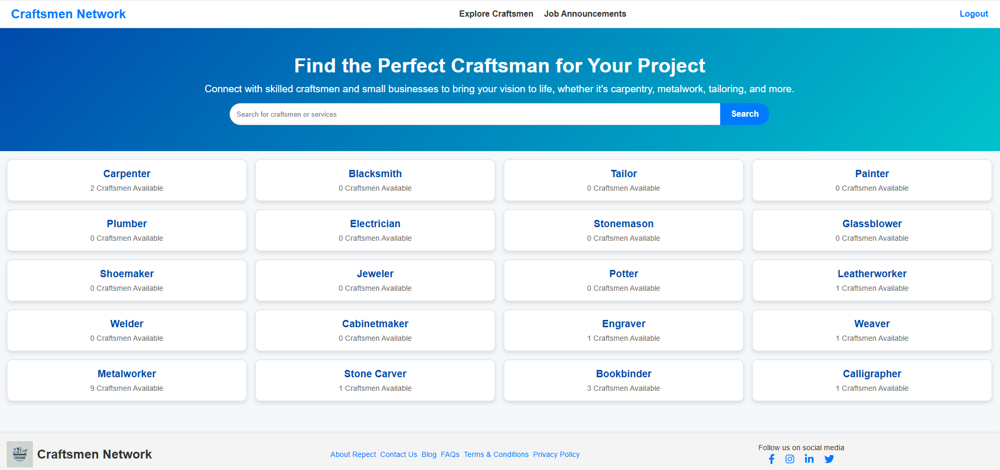
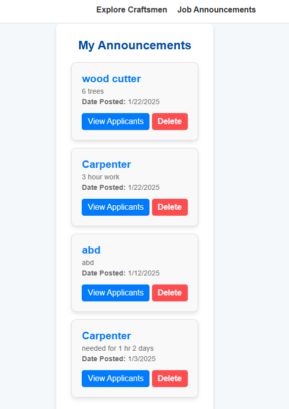
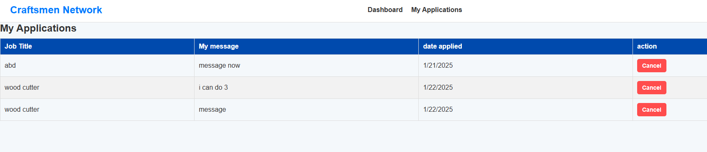

# Craftsmen and Small Business Network

**A full-stack web platform connecting craftspeople, small businesses, and clients through professional profiles, job opportunities, and communication tools.**

**Computer Science Capstone Project | Lebanese American University (LAU)**

## Overview

Finding skilled professionals and managing service requests can be challenging when profiles, job listings, and conversations are spread across different platforms. **Craftsmen and Small Business Network** brings these interactions together, helping clients discover service providers and giving craftspeople a space to showcase their skills and find opportunities.

## Key Features

- **Accounts and profiles:** User registration, authentication, and professional profiles for clients and craftspeople.
- **Craftsperson discovery:** Browse professionals and explore service categories.
- **Job announcements:** Publish service requests, manage listings, and review applicants.
- **Applications:** Apply to opportunities and track submitted applications.
- **Communication and community:** Direct messaging, real-time communication components, and community interactions.
- **Administration:** User-management and content-moderation interfaces.
- **AI-assisted visual product matching** to help users discover visually similar products from small businesses.

## Project Screenshots

### Explore Craftspeople

Browse skilled professionals and search by service category.



### Post a Job

Create service requests with job details, budget, and location.


### Manage Announcements

Review published jobs and their applicants.



### Track Applications

View and manage applications submitted to job listings.



## Technology Stack

| Area | Technologies |
| --- | --- |
| Frontend | HTML, CSS, JavaScript, Tailwind CSS |
| Backend | Node.js, Express.js |
| Database | MongoDB, Mongoose |
| Authentication | JWT, bcrypt |
| Real-time communication | Socket.IO, WebSockets |
| AI & Computer Vision | AI-assisted image matching, visual similarity search, product recognition |
| Email and file uploads | Nodemailer, Multer |
| Tooling | npm, Git, GitHub, Vite configuration |

## Getting Started

**Requirements:** Node.js, npm, and a MongoDB connection.

1. Clone the repository and enter the backend directory:

   ```bash
   git clone https://github.com/talahareb/Craftsmen-Small-Business-Network.git
   cd Craftsmen-Small-Business-Network/backend
   ```

2. Install dependencies:

   ```bash
   npm install
   ```

3. Create `backend/.env` using `backend/.env.example` as a reference:

   ```dotenv
   MONGODB_URI=your_mongodb_connection_string
   JWT_SECRET=your_secret_value
   EMAIL_USER=your_email_address
   EMAIL_PASS=your_email_app_password
   PORT=5001
   ```

   Keep real credentials out of Git.

4. Start the backend:

   ```bash
   node server.js
   ```

The example configuration uses port `5001`. Frontend access depends on the project's local setup.

## Project Structure

```text
Craftsmen-Small-Business-Network/
├── backend/
│   ├── middleware/
│   ├── models/
│   ├── routes/
│   └── server.js
├── frontend/
│   ├── assets/
│   ├── js/
│   ├── pages/
│   └── style/
├── screenshots/
└── README.md
```

## Key Concepts

- **Full-stack development:** Connecting a web interface to backend services and database operations.
- **REST API design:** Organizing server functionality into routes and data models.
- **Authentication and authorization:** Managing user accounts and protected application workflows.
- **Real-time communication:** Supporting interactive messaging using Socket.IO and WebSockets.
- **Data management:** Modeling profiles, job announcements, and applications with MongoDB.
- **Artificial Intelligence & Computer Vision:** Integrating AI-assisted image matching to identify visually similar products and enhance product discovery.

